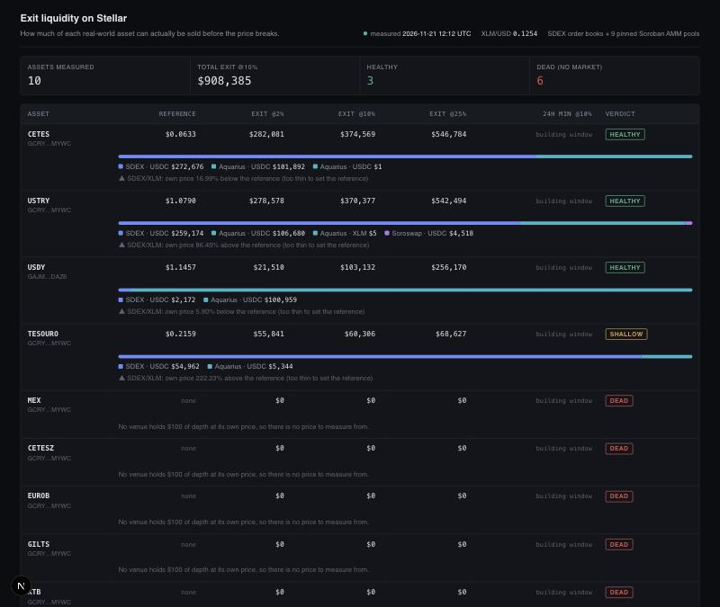

# Pocky

**Market-depth validation for real-world assets on Stellar.**

A price feed tells a lender what one token is worth. Pocky tells it **how much of that token
could actually be sold right now** before the price collapses, so collateral can be capped
by what the market can absorb.

> February 2026: the YieldBlox pool on Blend lost $10.97M against a token whose price was
> reported correctly, on a market where almost nothing could be sold. Auditors prescribed
> market depth validation afterwards. Today's checks read the SDEX order book only, and
> on Stellar much of the RWA market is not there.

## What it measures

For each asset, at 2%, 10% and 25% bands: the USD that could be raised by selling across
Stellar's order books and AMM pools (SDEX, Aquarius including concentrated pools, Soroswap) before the **average** sale price
falls more than the band below the reference price. The published figure is the **minimum
over a 24-hour window**, so liquidity that is parked and pulled cannot inflate it.

Every venue is measured from **one reference price** per asset, the median of the venues
that hold real depth, so no venue can vouch for its own price.

Live run, 21 Nov 2026, 10% band, SDEX order books plus nine Soroban AMM pools
([full output](docs/measurements/2026-11-21-all-venues.md)):

| Asset | Exit on Stellar | Where it is | Verdict |
| --- | ---: | --- | --- |
| USTRY | $381,836 | SDEX $271K, Aquarius $107K, Soroswap $4.5K | healthy |
| CETES | $352,896 | SDEX $267K, Aquarius $85K | healthy |
| USDY | $109,377 | Aquarius $107K, SDEX $2.2K | healthy |
| TESOURO | $60,335 | SDEX $55K, Aquarius $5.3K | shallow |
| six Etherfuse bond tokens | $0 | bids only, no price anywhere | dead |
| deJAAA | $0, with $3.56M borrowed against it (research, 19 Nov) | no Stellar venue | dead |



## Where Pocky sits

Oracle Shield asks whether a price can be trusted. Damper asks what it costs to clear the
order book. Pocky answers the lender's question: **how many dollars of this collateral can be
sold across Stellar's order books and AMM pools before the liquidation bonus is gone.**

- **Order books and AMM pools together.** USDY's market is an Aquarius pool: an SDEX-only
  view sees about 2% of it. For USTRY it misses about 30%.
- **No outside market needed.** The reference price comes from Stellar venues with real
  depth, so it works for tokens that trade on no exchange, which is every Etherfuse token.
  A check that compares against an exchange price cannot cover them.
- **Continuous, not a report.** RedStone's October 2026 RWA research measured exit depth for
  USTRY, CETES and USDY once. Pocky measures it every half hour, keeps the history and
  publishes it on-chain.
- **Computed, not quoted.** Other exit-cost services (sounding, live since Oct 2026) ask each
  venue's quote API. Pocky reads the books and pool state itself and checks every pool's
  reserves against its token balances, so a venue cannot report depth it does not hold.
- **A cap, not a score.** The output is a USD figure per band, a liquidation curve and a
  collateral cap a lender can enforce, published on-chain.
- **Not yet counted:** Curve (on Stellar since 29 Oct 2026), Comet, Stellar Broker and Sushi
  pools (since Sep 2026, including deJAAA). Venues left out can only understate depth; adding them is plan 2.10.
- **Built to be read by others.** The AMM-inclusive depth figure is the input both of the
  above lack; a circuit breaker or a price guard can read it rather than rebuild it.

Every rule behind the figures, step by step: [`docs/METHODOLOGY.md`](docs/METHODOLOGY.md).

**The five-minute story, with live numbers: [`docs/DEMO.md`](docs/DEMO.md).** A full scan of
10 assets across 29 venues takes about 4 seconds; the depth maths for one asset's full
liquidation curve takes 22 µs.

## Layout

| Path | What | Language |
| --- | --- | --- |
| `crates/pocky-core` | Pure depth math: fixed-point, order-book and AMM exit, verdicts, windowed minimum | Rust, no I/O |
| `crates/pocky-ingest` | Horizon, Soroban RPC and SEP-1 clients; pool verification | Rust |
| `crates/pocky-cli` | `pocky measure` | Rust |
| `crates/pocky-api` | Scheduled measurement, snapshot store, read-only HTTP API | Rust (axum) |
| `crates/pocky-publisher` | Publishes the windowed minimum to the oracle | Rust |
| `contracts/depth-oracle` | On-chain depth oracle with SEP-40-style reads | Rust / Soroban |
| `contracts/demo-lender` | Demo pool that caps collateral by the depth oracle (local only) | Rust / Soroban |
| `web/` | Dashboard over the API | TypeScript / Next.js |
| `docs/` | Idea, architecture, plan, security model | |

## Build and test

```bash
cargo test --workspace
cargo clippy --workspace --all-targets -- -D warnings

# contract (own workspace)
cd contracts/depth-oracle && cargo test
stellar contract build   # needs stellar-cli v25.2+
```

### See a lender refuse collateral the market cannot absorb

```bash
stellar container start local
(cd contracts/demo-lender && stellar contract build)
./scripts/blocked-borrow-demo.sh
```

### Run the oracle on a local network

```bash
stellar container start local      # Docker quickstart, localhost only
./scripts/local-oracle-demo.sh
```

Deploys the contract, publishes live figures, reads them back, and checks that a stranger,
the admin, a replayed timestamp, a future-dated figure and a self-rotating publisher are all
rejected.

### Run the service and dashboard

```bash
cargo run --release -p pocky-api -- --once   # seed the store with one live run
cargo run --release -p pocky-api             # measure every 30 min, serve 127.0.0.1:8080
cd web && npm install && npm run dev         # dashboard on http://localhost:3100
```

| Endpoint | Returns |
| --- | --- |
| `GET /v1/latest` | latest run, every asset and venue (503 if older than 2h) |
| `GET /v1/assets/{code}` | latest report plus the 24h windowed minimum per band |
| `GET /v1/assets/{code}/history?band=1000&hours=24` | exit series for one band |
| `GET /v1/assets/{code}/cap?bonus_bps=500&safety_bps=5000` | collateral liquidatable at a liquidation bonus, and a recommended cap |
| `GET /health` | measurement loop status |

### On testnet

The depth oracle is live on Stellar testnet with **live mainnet figures**, so a protocol can
build against real numbers today: `CCOI2QVXHQIX7ZADUT5LSJPDAQSKPEINUK6HCMCSCZTWLB5BK7W4CBUQ`.
How to read it from the CLI or a contract: [`docs/deployments/testnet.md`](docs/deployments/testnet.md).
Deployment of every piece: [`docs/DEPLOY.md`](docs/DEPLOY.md).

## Status

Depth math, live ingestion (SDEX books and Soroban AMM pools, with SEP-1 issuer checks and
on-chain pool verification) and the on-chain oracle are complete:

```bash
cargo run --release -p pocky-cli -- measure          # table
cargo run --release -p pocky-cli -- measure --json   # JSON
cargo run --release -p pocky-cli -- measure --no-amm # SDEX order books only
```

Pools are read from Soroban RPC by simulation only. The API service and dashboard run
locally. Next: the collateral-at-risk view and a local demo where the oracle blocks a borrow
against a thin market. See [`docs/PLAN.md`](docs/PLAN.md) for every phase and
subphase, and [`docs/SECURITY.md`](docs/SECURITY.md) for the threat model.

## Principles

- Read-only: the engine never signs anything; only the publisher signs, and only to our own
  contract.
- Fail closed: missing or stale data publishes nothing.
- Conservative: every rounding understates depth.
- Reproducible: any figure can be recomputed from its stored snapshot.

## License

Apache-2.0. See [LICENSE](LICENSE).
