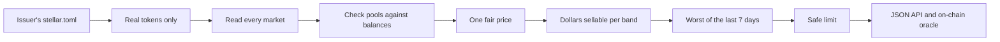

Orbit runs the same pipeline every 30 minutes, at a randomized time.

<Steps>
  <Step title="Confirm the token is real">
    Every issuer publishes its official tokens in a file on its own website (`stellar.toml`,
    SEP-1). Orbit only measures a token whose code and issuer (or contract) appear there.
    Look-alike tokens with the same name are ignored. [More](/concepts/token-verification)
  </Step>
  <Step title="Read every market">
    The SDEX order books against USDC and XLM, and pinned AMM pools on Aquarius, Soroswap and
    Sushi. All reads are simulations: nothing is signed. [More](/concepts/venues)
  </Step>
  <Step title="Check each pool">
    A pool's claimed reserves and quotes are checked against what the token contracts say it
    holds. A pool that claims more than it holds is dropped.
  </Step>
  <Step title="Agree on one price">
    Each market has its own price. Orbit takes the middle price of the markets that hold real
    money, so one thin or pushed market cannot set it. [More](/concepts/reference-price)
  </Step>
  <Step title="Add up the buyers">
    For each market, how much it would pay before the average sale price falls a given band
    below that price, summed in USD. [More](/concepts/exit-liquidity)
  </Step>
  <Step title="Keep the worst of the week">
    The published figure is the lowest reading in the last 7 days, and only if the last 24 hours
    hold at least 12 readings with no gap over 2 hours. [More](/concepts/worst-of-the-day)
  </Step>
  <Step title="Turn it into a limit">
    At a lender's liquidation bonus, how much collateral could be cleared, halved as a safety
    margin. [More](/concepts/safe-limit)
  </Step>
  <Step title="Publish">
    Static JSON for apps and people, and a Soroban contract for lending contracts.
  </Step>
</Steps>

## Arithmetic

All figures use 7-decimal fixed point, with no floating point. Every rounding goes the
direction that makes depth smaller, never larger. A token with more decimals (Centrifuge tokens
have 18, Solv's 8) is converted exactly before any maths.
